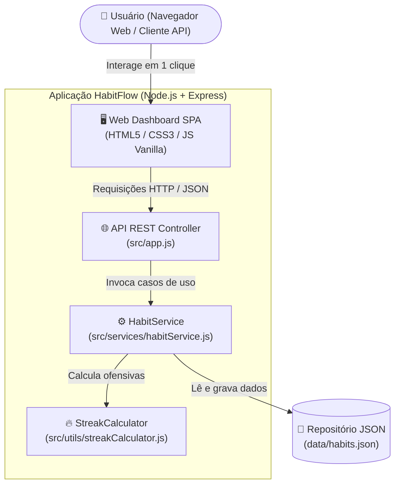
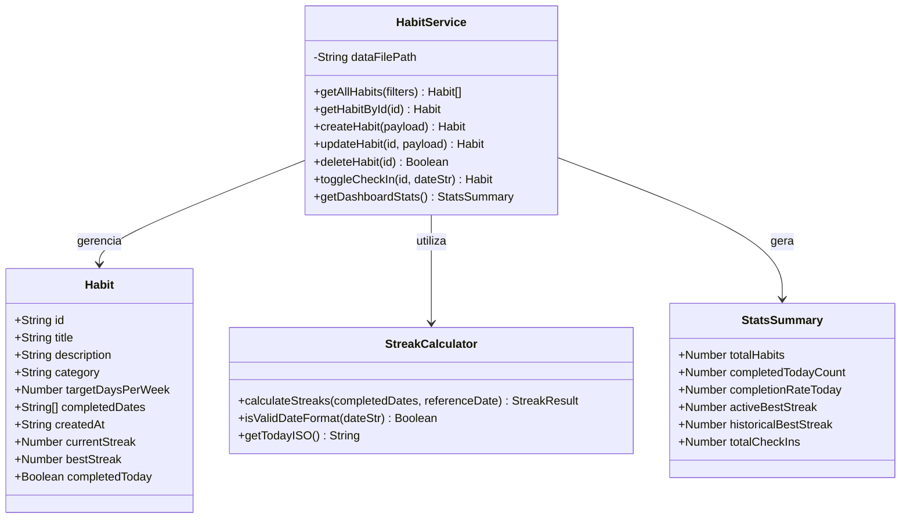
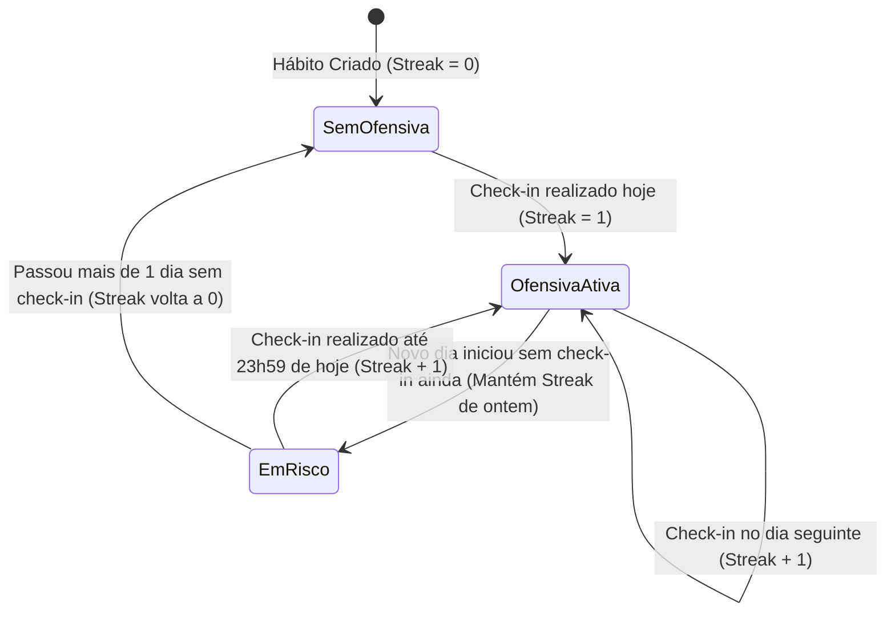

# 🏗️ Documentação Complementar de Engenharia: Arquitetura e Diagramas

Este documento apresenta a modelagem arquitetural (C4 Model — Nível de Containers e Componentes), o Diagrama de Classes / Modelo de Dados e o fluxo de estados de *streaks* do sistema **HabitFlow**.

---

## 1. Arquitetura do Sistema (C4 Model — Containers & Componentes)

O **HabitFlow** adota uma arquitetura em camadas enxuta e desacoplada:

1. **Camada de Apresentação (`src/public/`):** Aplicação Web Single-Page responsiva construída com HTML5 semântico, CSS3 moderno (Grid/Flexbox) e JavaScript ES6+ que consome a API REST via `fetch`.
2. **Camada de Controle / Rotas (`src/app.js`):** Servidor Express responsável por roteamento HTTP, parsing de JSON, tratamento padronizado de erros e entrega dos arquivos estáticos.
3. **Camada de Negócio (`src/services/habitService.js` & `src/utils/streakCalculator.js`):** Isola todas as validações, regras de negócio e o algoritmo matemático de cálculo de ofensivas (*streaks*).
4. **Camada de Persistência (`data/habits.json`):** Repositório persistente em arquivo JSON estruturado com inicialização automática.

---

## 2. Diagrama de Classes e Modelo de Dados

---

## 3. Algoritmo de Cálculo de Ofensivas (State Diagram)

O diagrama de estados abaixo demonstra como a ofensiva (*streak*) de um hábito evolui conforme os *check-ins* diários do usuário:

---

## 4. Especificação dos Endpoints da API REST

| Método | Rota | Descrição | Status de Sucesso |
| :---: | :--- | :--- | :---: |
| `GET` | `/api/health` | Verifica integridade e versão da API | `200 OK` |
| `GET` | `/api/habits` | Lista hábitos (suporta `?category=` e `?search=`) | `200 OK` |
| `GET` | `/api/habits/stats` | Retorna estatísticas globais para o Dashboard | `200 OK` |
| `GET` | `/api/habits/:id` | Busca detalhes e histórico de um hábito específico | `200 OK` |
| `POST` | `/api/habits` | Cadastra um novo hábito validado | `201 Created` |
| `PUT` | `/api/habits/:id` | Atualiza título, descrição, categoria ou meta semanal | `200 OK` |
| `DELETE` | `/api/habits/:id` | Remove permanentemente um hábito | `200 OK` |
| `POST` | `/api/habits/:id/checkin` | Marca ou desmarca (*toggle*) conclusão na data | `200 OK` |
