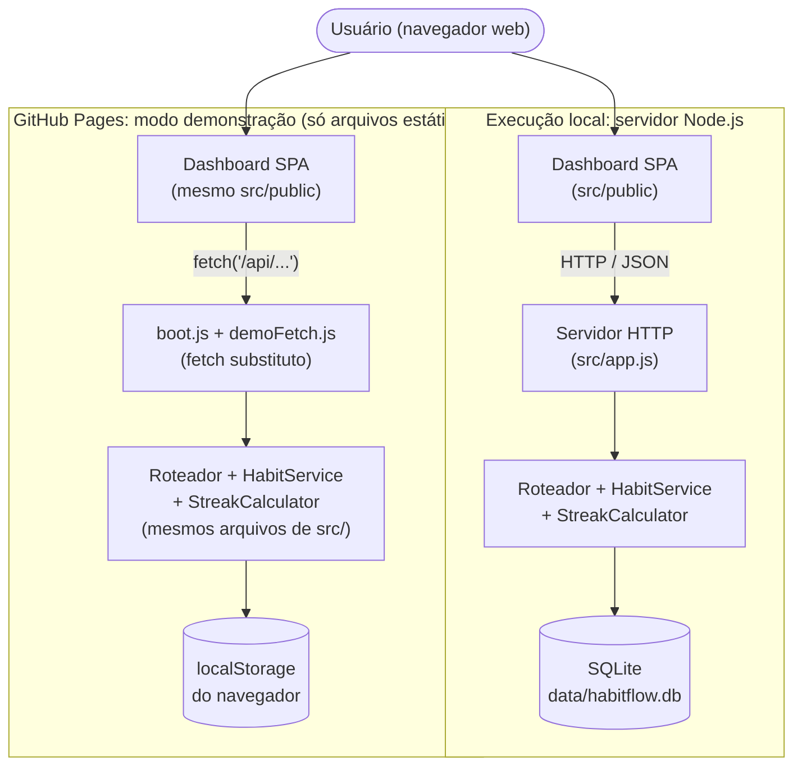
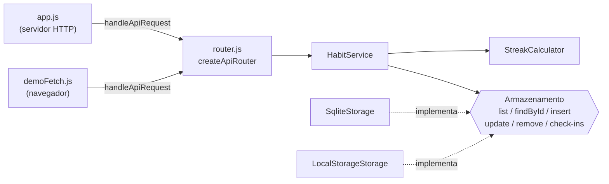
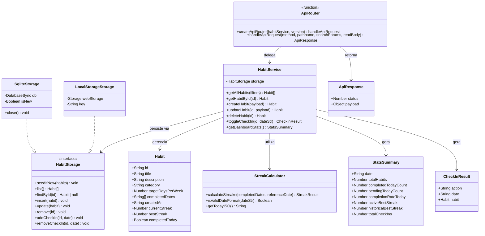
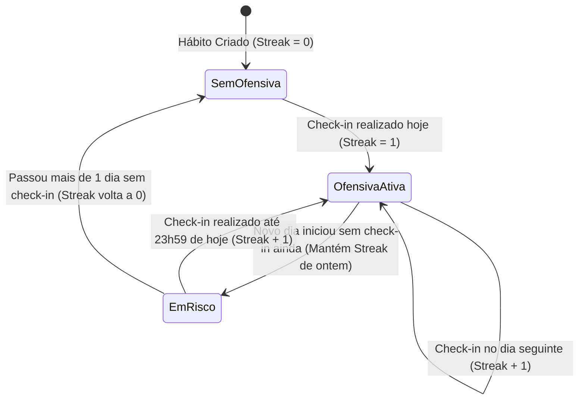

# Documentação Complementar de Engenharia: Arquitetura e Diagramas

Este documento apresenta a modelagem arquitetural (C4 Model — Nível de Containers e Componentes), o Diagrama de Classes / Modelo de Dados, o fluxo de estados de *streaks* e a especificação da API REST do sistema **HabitFlow**.

---

## 1. Arquitetura do Sistema (C4 Model — Containers & Componentes)

O **HabitFlow** adota uma arquitetura em camadas enxuta, com dois pontos de troca (*seams*) que permitem rodar as mesmas regras de negócio em dois ambientes:

1. **Camada de Apresentação (`src/public/`):** Aplicação Web Single-Page responsiva construída com HTML5 semântico, CSS3 moderno (Grid/Flexbox) e JavaScript ES6+ que consome a API REST via `fetch`.
2. **Adaptadores de entrada:**
   - **Servidor HTTP (`src/app.js`):** módulo `http` nativo do Node.js; cuida de CORS, leitura do corpo da requisição e entrega dos arquivos estáticos, e delega tudo que começa com `/api/` ao roteador.
   - **Modo demonstração (`src/demo/`):** no GitHub Pages, `boot.js` carrega os módulos no navegador e substitui o `fetch` de `/api/*` por `demoFetch.js`, que chama o mesmo roteador.
3. **Roteador da API (`src/api/router.js`):** função pura `createApiRouter({ habitService, version })` que recebe método, caminho, parâmetros e o corpo da requisição e devolve `{ status, payload }`. Concentra rotas, códigos de status e o formato das mensagens de erro, sem depender de `http`.
4. **Camada de Negócio (`src/services/habitService.js` & `src/utils/streakCalculator.js`):** isola as validações, as regras de negócio e o algoritmo de cálculo de ofensivas (*streaks*). O `HabitService` recebe o armazenamento por injeção e não conhece arquivo nem navegador.
5. **Adaptadores de armazenamento (`src/storage/`):** implementam operações por registro (`list`, `findById`, `insert`, `update`, `remove`, `addCheckIn`, `removeCheckIn`) e `seedIfNew(habits)`, que grava os hábitos de exemplo só quando o armazenamento acabou de ser criado.
   - **`SqliteStorage`:** banco SQLite com o módulo nativo `node:sqlite`, em `data/habitflow.db` ou no caminho de `DATABASE_FILE` (servidor Node). Hábitos e check-ins ficam em tabelas separadas; cada check-in é uma linha, então escritas simultâneas de processos diferentes não se sobrescrevem.
   - **`LocalStorageStorage`:** grava no `localStorage` do navegador (GitHub Pages).

### 1.1 Containers



### 1.2 Componentes



---

## 2. Diagrama de Classes e Modelo de Dados



---

## 3. Algoritmo de Cálculo de Ofensivas (State Diagram)

O diagrama de estados abaixo demonstra como a ofensiva (*streak*) de um hábito evolui conforme os *check-ins* diários do usuário:



---

## 4. Especificação dos Endpoints da API REST

| Método | Rota | Descrição | Status de Sucesso |
| :---: | :--- | :--- | :---: |
| `GET` | `/api/health` | Verifica integridade e versão da API | `200 OK` |
| `GET` | `/api/habits` | Lista hábitos (suporta `?category=`, `?status=completed\|pending` e `?search=`) | `200 OK` |
| `GET` | `/api/habits/stats` | Retorna estatísticas globais para o Dashboard | `200 OK` |
| `GET` | `/api/habits/:id` | Busca detalhes e histórico de um hábito específico | `200 OK` |
| `POST` | `/api/habits` | Cadastra um novo hábito validado | `201 Created` |
| `PUT` | `/api/habits/:id` | Atualiza título, descrição, categoria ou meta semanal | `200 OK` |
| `DELETE` | `/api/habits/:id` | Remove permanentemente um hábito e retorna o hábito removido | `200 OK` |
| `POST` | `/api/habits/:id/checkin` | Marca ou desmarca (*toggle*) conclusão na data (`{ "date": "YYYY-MM-DD" }`, padrão: hoje) | `200 OK` |

Erros seguem um formato único, com um código estável para o cliente tratar e a mensagem em português:

```json
{
  "error": {
    "code": "VALIDATION_ERROR",
    "message": "O título do hábito é obrigatório e deve ter pelo menos 3 caracteres.",
    "fields": { "title": "O título do hábito é obrigatório e deve ter pelo menos 3 caracteres." }
  }
}
```

| Status | `code` | Quando |
| :---: | :--- | :--- |
| `400` | `VALIDATION_ERROR` | Campo inválido (`fields` indica qual) ou corpo que não é JSON válido (sem `fields`) |
| `403` | `FORBIDDEN` | Caminho de arquivo estático fora de `src/public/` |
| `404` | `NOT_FOUND` | Hábito, endpoint ou arquivo estático inexistente |
| `500` | `INTERNAL_ERROR` | Falha inesperada; a mensagem é sempre genérica e não expõe o erro interno |

As mesmas rotas e respostas valem no modo demonstração, porque ele usa o mesmo `router.js`.
